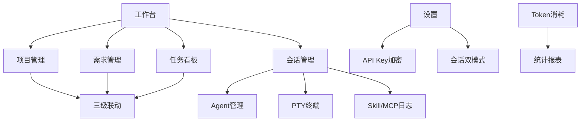
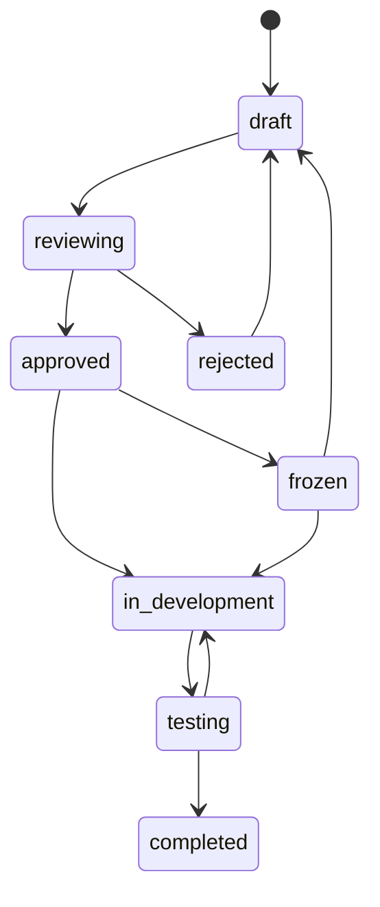
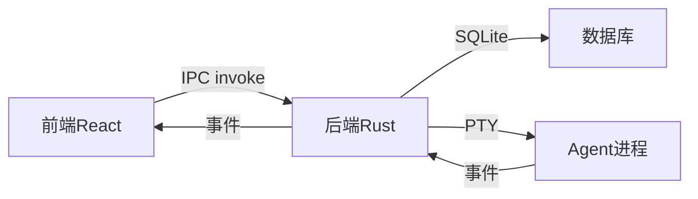

# ACE - AI Collaboration Engine 功能规格文档

> 版本：v1.0 | 生成日期：2026-09-20 | 基于代码库只读审计
> 系统名称：AI Collaboration Engine (ACE) v2.1.0
> 技术栈：Tauri 2.0 + React + SQLite + Zustand

---

## 一、功能总览

### 1.1 现有功能清单

| 功能编号 | 功能名称          | 来源                                    | 当前状态 | 所属模块 |
| -------- | ----------------- | --------------------------------------- | -------- | -------- |
| F001     | 工作台概览        | Workspace.tsx                           | 已实现   | 工作区   |
| F002     | 项目管理          | Projects.tsx, ProjectDetail.tsx         | 已实现   | 工作区   |
| F003     | 需求管理          | Requirements.tsx, RequirementDetail.tsx | 已实现   | 工作区   |
| F004     | 任务看板          | Board.tsx, TaskDetail.tsx               | 已实现   | 工作区   |
| F005     | Agent管理         | Agents.tsx                              | 已实现   | 工作区   |
| F006     | 会话管理          | Sessions.tsx, SessionDetail.tsx         | 已实现   | 工作区   |
| F007     | Skill管理         | SkillManagement.tsx                     | 部分实现 | 工作区   |
| F008     | 代码提交          | Commits.tsx                             | 已实现   | 工作区   |
| F009     | 统计报表          | Statistics.tsx                          | 已实现   | 数据     |
| F010     | Token消耗         | Cost.tsx                                | 已实现   | 数据     |
| F011     | 系统设置          | Settings.tsx                            | 已实现   | 系统     |
| F012     | 系统托盘          | tray.rs                                 | 已实现   | 系统     |
| F013     | 错误处理          | ErrorBoundary.tsx, errors.rs            | 已实现   | 系统     |
| F014     | 数据库迁移        | migration.rs                            | 已实现   | 基础设施 |
| F015     | API Key加密       | crypto.rs                               | 部分实现 | 安全     |
| F016     | PTY终端           | AgentTerminal.tsx, pty.rs               | 已实现   | Agent    |
| F017     | 任务评论          | TaskDetail.tsx, task_comments表         | 已实现   | 任务     |
| F018     | 三级联动          | ProjectDetail.tsx                       | 已实现   | 项目     |
| F019     | 会话双模式        | Settings.tsx (session_mode)             | 部分实现 | 会话     |
| F020     | Skill/MCP执行日志 | SessionDetail.tsx                       | 已实现   | Agent    |

### 1.2 建议新增功能清单

| 建议编号 | 功能名称     | 功能域     | 优先级 | 实现成本 |
| -------- | ------------ | ---------- | ------ | -------- |
| S001     | 需求字段扩展 | 需求管理   | Must   | 中       |
| S002     | 任务字段扩展 | 任务管理   | Must   | 中       |
| S003     | 富文本编辑器 | 需求管理   | Must   | 高       |
| S004     | 附件管理     | 需求管理   | Should | 低       |
| S005     | 操作历史审计 | 需求/任务  | Should | 中       |
| S006     | Skill CRUD   | Skill管理  | Must   | 中       |
| S007     | 分页系统     | 全局       | Should | 中       |
| S008     | 数据导入导出 | 数据管理   | Could  | 高       |
| S009     | 通知系统     | 通知消息   | Could  | 高       |
| S010     | 暗色主题     | 配置个性化 | Could  | 中       |

---

## 二、现有功能详细描述

### F001: 工作台概览

**功能编号与名称：** F001 工作台概览
**目标用户与角色：** 单人开发者（唯一用户）
**使用场景：** 启动应用后查看项目整体状态
**前置条件：** 应用已初始化，数据库已创建
**主流程：**

1. 用户启动应用，默认显示工作台
2. 系统加载需求、任务、项目数据
3. 显示4个统计卡片（需求总数、任务总数、已完成、已阻塞）
4. 显示最近活动列表（合并需求和任务，按时间排序）
5. 显示项目列表（最多5个）
   **异常流程：** 数据加载失败显示错误提示
   **边界条件：** 无数据时显示空状态提示
   **输入与输出：** 无输入，输出统计数据和列表
   **依赖关系：** 依赖RequirementsStore、TasksStore、listProjects API
   **约束条件：** 列表最多显示8条活动、5个项目
   **状态变化：** 无
   **权限控制：** 无（单用户）
   **验收标准：**

```
Given 应用已启动
When 查看工作台
Then 显示4个统计卡片和最近活动列表
And 点击卡片可跳转到对应页面
```

### F002: 项目管理

**功能编号与名称：** F002 项目管理
**目标用户与角色：** 单人开发者
**使用场景：** 创建和管理项目
**前置条件：** 应用已初始化
**主流程：**

1. 用户点击"项目管理"进入项目列表
2. 可搜索项目（按名称、描述）
3. 点击"新建项目"打开创建弹窗
4. 填写项目名称、描述、标识（前缀）
5. 创建成功后显示在列表中
6. 点击项目进入详情页（5个Tab：概览、需求、任务、Skill配置、MCP配置）
   **异常流程：**

- 项目名称为空：按钮置灰
- 项目名称超过100字符：前端拦截
- 删除有关联数据的项目：后端拒绝
  **边界条件：**
- 项目标识最大10字符
- 项目名称最大100字符
  **输入与输出：**
- 输入：项目名称（必填）、描述、标识
- 输出：Project对象
  **依赖关系：** 依赖ProjectsStore、ProjectService
  **约束条件：** 无
  **状态变化：** 项目状态：active → paused → archived
  **权限控制：** 无
  **验收标准：**

```
Given 项目列表有3个项目
When 点击"新建项目"并填写名称
Then 创建成功，列表刷新显示新项目

Given 项目有5个关联需求
When 进入项目详情页的需求Tab
Then 显示5个需求的标题、状态、优先级
```

### F003: 需求管理

**功能编号与名称：** F003 需求管理
**目标用户与角色：** 单人开发者
**使用场景：** 创建和管理需求
**前置条件：** 应用已初始化
**主流程：**

1. 用户点击"需求管理"进入需求列表
2. 可搜索需求、按状态/类型筛选
3. 点击"新建需求"打开创建弹窗
4. 填写标题、描述、优先级、类型
5. 创建成功后自动跳转到需求详情页
6. 详情页可编辑基本信息、生成PRD文档
   **异常流程：**

- 标题为空：按钮置灰
- 标题超过200字符：前端拦截
- 非法状态流转：后端拒绝
  **边界条件：**
- 标题最大200字符
- 状态流转遵循状态机规则
  **输入与输出：**
- 输入：标题（必填）、描述、优先级、类型
- 输出：Requirement对象
  **依赖关系：** 依赖RequirementsStore、RequirementService
  **约束条件：** 状态流转规则：draft→reviewing→approved→in_development→testing→completed
  **状态变化：** 需求状态：draft → reviewing → approved → in_development → testing → completed
  **权限控制：** 无
  **验收标准：**

```
Given 需求处于"reviewing"状态
When 将状态改为"approved"
Then 允许流转，需求详情页更新状态

Given 需求处于"completed"状态
When 尝试改回"draft"
Then 拒绝操作，提示"已完成的需求不可回退"
```

### F004: 任务看板

**功能编号与名称：** F004 任务看板
**目标用户与角色：** 单人开发者
**使用场景：** 查看和管理任务状态
**前置条件：** 应用已初始化
**主流程：**

1. 用户点击"任务看板"进入看板视图
2. 显示4列：待开发、开发中、已阻塞、已完成
3. 可搜索任务、按类型筛选
4. 点击"新建任务"打开创建弹窗
5. 填写标题、类型、优先级
6. 拖拽任务卡片可更改状态
7. 点击任务卡片进入详情页
   **异常流程：**

- 标题为空：按钮置灰
- 拖拽到相同列：忽略
  **边界条件：**
- 任务标题最大200字符
  **输入与输出：**
- 输入：标题（必填）、类型、优先级
- 输出：Task对象
  **依赖关系：** 依赖TasksStore、TaskService
  **约束条件：** 任务状态：pending → in_progress → completed / blocked
  **状态变化：** 任务状态通过拖拽更新
  **权限控制：** 无
  **验收标准：**

```
Given 看板有5个任务
When 拖拽任务从"待开发"到"开发中"
Then 任务状态更新，卡片移动到对应列

Given 任务处于"开发中"状态
When 点击任务卡片
Then 进入任务详情页，显示完整信息
```

### F005: Agent管理

**功能编号与名称：** F005 Agent管理
**目标用户与角色：** 单人开发者
**使用场景：** 发现和启动本地CLI Agent
**前置条件：** 已安装Claude Code或Codex CLI
**主流程：**

1. 用户点击"Agent"进入Agent管理页
2. 系统自动发现本地安装的Agent
3. 显示可用Agent列表（名称、版本、路径）
4. 点击"启动"按钮启动Agent
5. 显示运行中的会话列表
6. 可查看终端、停止Agent
   **异常流程：**

- 未检测到Agent：显示提示信息
- 启动失败：显示错误信息
  **边界条件：**
- 无
  **输入与输出：**
- 输入：Agent路径
- 输出：AgentSession对象
  **依赖关系：** 依赖AgentService、PtyService
  **约束条件：** 最大同时运行3个会话（设计文档）
  **状态变化：** 会话状态：created → launching → running → completed/failed
  **权限控制：** 无
  **验收标准：**

```
Given 系统已安装Claude Code
When 点击"刷新检测"
Then 显示可用的Agent列表

Given 点击"启动"按钮
When Agent启动成功
Then 显示运行中的会话，终端可交互
```

### F006: 会话管理

**功能编号与名称：** F006 会话管理
**目标用户与角色：** 单人开发者
**使用场景：** 查看和管理Agent执行会话
**前置条件：** 至少有一个会话记录
**主流程：**

1. 用户点击"会话管理"进入会话列表
2. 显示统计卡片（总会话、运行中、已完成、失败）
3. 可按状态筛选、搜索会话
4. 运行中的会话可查看终端、终止
5. 已完成的会话可查看详情
6. 详情页显示：终端输出、Skill执行记录、MCP调用记录
   **异常流程：**

- 会话不存在：显示错误提示
- 终止失败：显示错误信息
  **边界条件：**
- 无
  **输入与输出：**
- 输入：筛选条件
- 输出：AgentSession列表
  **依赖关系：** 依赖SessionsStore、AgentService
  **约束条件：** 无
  **状态变化：** 会话状态：created → launching → running → completed/failed/terminated
  **权限控制：** 无
  **验收标准：**

```
Given 有5个会话记录
When 按"运行中"筛选
Then 只显示运行中的会话

Given 会话运行中
When 点击"终止"按钮
Then 会话状态变为"terminated"
```

### F007: Skill管理

**功能编号与名称：** F007 Skill管理
**目标用户与角色：** 单人开发者
**使用场景：** 管理PRD生成模板和技能配置
**前置条件：** 应用已初始化
**主流程：**

1. 用户点击"Skill管理"进入Skill列表
2. 显示所有Skill（内置和自定义）
3. 可展开查看模板内容
4. 可复制、编辑、删除（TODO：未实现）
   **异常流程：**

- 无
  **边界条件：**
- 内置Skill不可删除
  **输入与输出：**
- 输入：无
- 输出：PrdSkill列表
  **依赖关系：** 依赖PrdSkillService
  **约束条件：** 内置Skill只读
  **状态变化：** 无
  **权限控制：** 无
  **验收标准：**

```
Given 有3个内置Skill和2个自定义Skill
When 查看Skill列表
Then 显示所有Skill，内置Skill标记为"内置"

Given 选中一个自定义Skill
When 点击"删除"按钮
Then TODO: 删除功能未实现
```

### F008: 代码提交

**功能编号与名称：** F008 代码提交
**目标用户与角色：** 单人开发者
**使用场景：** 查看Git提交历史
**前置条件：** 已配置项目路径
**主流程：**

1. 用户点击"代码提交"进入提交历史页
2. 显示统计卡片（总提交、今日、本周、当前分支）
3. 可搜索提交（按消息、哈希、作者）
4. 点击提交可展开查看Diff
5. 可复制提交哈希
   **异常流程：**

- 未配置项目路径：显示错误提示
- 获取提交失败：显示错误信息
  **边界条件：**
- 最多显示100条提交
  **输入与输出：**
- 输入：搜索关键词
- 输出：CommitRecord列表
  **依赖关系：** 依赖GitService
  **约束条件：** 需要配置项目路径
  **状态变化：** 无
  **权限控制：** 无
  **验收标准：**

```
Given 已配置项目路径
When 查看提交历史
Then 显示最近100条提交记录

Given 输入搜索关键词
When 按回车搜索
Then 只显示匹配的提交记录
```

### F009: 统计报表

**功能编号与名称：** F009 统计报表
**目标用户与角色：** 单人开发者
**使用场景：** 查看任务执行效率统计
**前置条件：** 应用已初始化
**主流程：**

1. 用户点击"统计报表"进入统计页
2. 显示概览卡片（总任务数、完成率、进行中、Token消耗）
3. 显示任务状态分布（进度条）
4. 显示任务类型分布（进度条）
5. 显示优先级分布（进度条）
6. 显示Token消耗统计
   **异常流程：**

- 无数据：显示空状态
  **边界条件：**
- 无
  **输入与输出：**
- 输入：无
- 输出：StatisticsData对象
  **依赖关系：** 依赖StatisticsService
  **约束条件：** 无
  **状态变化：** 无
  **权限控制：** 无
  **验收标准：**

```
Given 有10个任务，6个已完成
When 查看统计报表
Then 显示完成率60%
```

### F010: Token消耗

**功能编号与名称：** F010 Token消耗
**目标用户与角色：** 单人开发者
**使用场景：** 追踪和管理LLM Token消耗
**前置条件：** 应用已初始化
**主流程：**

1. 用户点击"Token消耗"进入消耗页
2. 显示预算概览（进度条）
3. 显示统计卡片（总消耗、输入、输出、总费用）
4. 显示近30天消耗趋势（条形图）
5. 显示按模型分布（进度条）
6. 可同步本地数据、设置预算
   **异常流程：**

- 超过预算：显示警告
- 同步失败：显示错误信息
  **边界条件：**
- 预算阈值0-1
  **输入与输出：**
- 输入：月度上限、告警阈值
- 输出：TokenUsageSummary对象
  **依赖关系：** 依赖TokenService
  **约束条件：** 无
  **状态变化：** 无
  **权限控制：** 无
  **验收标准：**

```
Given 设置月度上限为200万tokens
When 消耗达到160万tokens
Then 显示预算警告
```

### F011: 系统设置

**功能编号与名称：** F011 系统设置
**目标用户与角色：** 单人开发者
**使用场景：** 配置平台参数和集成
**前置条件：** 应用已初始化
**主流程：**

1. 用户点击"设置"进入设置页
2. 配置LLM设置（Claude API Key）
3. 配置会话设置（自动/手动模式）
4. 配置项目设置（项目名称、路径）
5. 配置Git设置（自动提交模式、Commit模板）
6. 查看PRD Skill模板
7. 点击"保存设置"保存所有配置
   **异常流程：**

- 保存失败：显示错误信息
  **边界条件：**
- API Key类型：password
  **输入与输出：**
- 输入：各项配置值
- 输出：Settings对象
  **依赖关系：** 依赖SettingsStore
  **约束条件：** 无
  **状态变化：** 无
  **权限控制：** 无
  **验收标准：**

```
Given 输入Claude API Key
When 点击"保存设置"
Then 设置保存成功，下次启动自动加载
```

### F012: 系统托盘

**功能编号与名称：** F012 系统托盘
**目标用户与角色：** 单人开发者
**使用场景：** 最小化到系统托盘
**前置条件：** 应用已启动
**主流程：**

1. 应用启动时创建系统托盘图标
2. 右键托盘图标显示菜单：显示窗口、隐藏窗口、设置、退出
3. 点击"显示窗口"显示主窗口
4. 点击"隐藏窗口"隐藏主窗口
5. 点击"设置"显示窗口并导航到设置页
6. 点击"退出"退出应用
7. 关闭主窗口时隐藏到托盘（不退出）
   **异常流程：**

- 托盘创建失败：记录日志
  **边界条件：**
- 无
  **输入与输出：**
- 输入：用户操作
- 输出：窗口显示/隐藏/退出
  **依赖关系：** 依赖tray.rs
  **约束条件：** 无
  **状态变化：** 窗口状态：显示 ↔ 隐藏
  **权限控制：** 无
  **验收标准：**

```
Given 应用已启动
When 关闭主窗口
Then 窗口隐藏到托盘，应用继续运行

When 右键托盘图标
Then 显示菜单：显示窗口、隐藏窗口、设置、退出
```

### F013: 错误处理

**功能编号与名称：** F013 错误处理
**目标用户与角色：** 单人开发者
**使用场景：** 应用异常时显示友好错误页面
**前置条件：** 无
**主流程：**

1. React组件渲染出错时触发ErrorBoundary
2. 显示错误页面（图标、错误信息、重试按钮）
3. 点击"重试"恢复到正常状态
   **异常流程：**

- 无
  **边界条件：**
- 无
  **输入与输出：**
- 输入：Error对象
- 输出：错误页面
  **依赖关系：** 依赖ErrorBoundary.tsx
  **约束条件：** 无
  **状态变化：** hasError: false → true → false
  **权限控制：** 无
  **验收标准：**

```
Given 组件渲染出错
When ErrorBoundary捕获错误
Then 显示错误页面，点击"重试"恢复
```

### F014: 数据库迁移

**功能编号与名称：** F014 数据库迁移
**目标用户与角色：** 系统
**使用场景：** 应用启动时自动迁移数据库
**前置条件：** 无
**主流程：**

1. 应用启动时检查schema_version表
2. 获取当前版本号
3. 执行未应用的迁移
4. 更新版本号
   **异常流程：**

- 迁移失败：记录日志，应用继续运行
  **边界条件：**
- 无
  **输入与输出：**
- 输入：数据库路径
- 输出：迁移后的数据库
  **依赖关系：** 依赖migration.rs
  **约束条件：** 无
  **状态变化：** schema_version: 0 → 8
  **权限控制：** 无
  **验收标准：**

```
Given 数据库版本为7
When 应用启动
Then 自动执行版本8的迁移
```

### F015: API Key加密

**功能编号与名称：** F015 API Key加密
**目标用户与角色：** 系统
**使用场景：** 加密存储API Key
**前置条件：** 无
**主流程：**

1. 用户输入API Key
2. 使用AES-256-GCM加密
3. 密钥从密码派生（PBKDF2）
4. 加密后存储到数据库
5. 读取时解密显示
   **异常流程：**

- 加密失败：返回错误
- 解密失败：返回错误
  **边界条件：**
- 密码为空：使用默认密码
  **输入与输出：**
- 输入：API Key、密码
- 输出：加密后的字符串
  **依赖关系：** 依赖crypto.rs
  **约束条件：** AES-256-GCM + PBKDF2（100,000次迭代）
  **状态变化：** 无
  **权限控制：** 无
  **验收标准：**

```
Given 输入API Key "sk-ant-1234567890"
When 使用密码"my-password"加密
Then 生成加密字符串，解密后还原为原始API Key
```

### F016: PTY终端

**功能编号与名称：** F016 PTY终端
**目标用户与角色：** 单人开发者
**使用场景：** 与Agent进行交互式终端操作
**前置条件：** 会话已启动
**主流程：**

1. 在Sessions页点击"查看终端"
2. 打开AgentTerminal组件
3. 使用xterm.js渲染终端
4. 用户输入通过pty_write发送到Agent
5. Agent输出通过pty:event事件接收并显示
6. 支持搜索、导出日志、最大化
   **异常流程：**

- PTY写入失败：记录日志
- Agent退出：显示退出码
  **边界条件：**
- 终端回滚：10000行
  **输入与输出：**
- 输入：用户键盘输入
- 输出：Agent输出
  **依赖关系：** 依赖AgentTerminal.tsx、pty.rs
  **约束条件：** 无
  **状态变化：** isRunning: true → false
  **权限控制：** 无
  **验收标准：**

```
Given 会话运行中
When 打开终端
Then 可以输入命令，实时看到Agent输出
```

### F017: 任务评论

**功能编号与名称：** F017 任务评论
**目标用户与角色：** 单人开发者
**使用场景：** 在任务详情页添加评论
**前置条件：** 任务已创建
**主流程：**

1. 进入任务详情页
2. 查看评论列表
3. 输入评论内容
4. 按回车或点击发送按钮提交
5. 评论显示在列表中
6. 可删除评论
   **异常流程：**

- 评论为空：发送按钮禁用
- 删除失败：显示错误信息
  **边界条件：**
- 评论内容无长度限制（待确认）
  **输入与输出：**
- 输入：评论内容
- 输出：TaskComment对象
  **依赖关系：** 依赖TaskDetail.tsx、task_comments表
  **约束条件：** 无
  **状态变化：** 无
  **权限控制：** 无
  **验收标准：**

```
Given 任务详情页
When 输入评论内容并按回车
Then 评论添加成功，显示在列表中
```

### F018: 三级联动

**功能编号与名称：** F018 三级联动
**目标用户与角色：** 单人开发者
**使用场景：** 项目→需求→任务全链路查看
**前置条件：** 项目、需求、任务已创建
**主流程：**

1. 进入项目详情页
2. 切换到"需求"Tab查看关联需求
3. 切换到"任务"Tab查看关联任务
4. 点击需求/任务可跳转到详情页
   **异常流程：**

- 无关联数据：显示空状态
  **边界条件：**
- 无
  **输入与输出：**
- 输入：项目ID
- 输出：关联的需求和任务列表
  **依赖关系：** 依赖ProjectDetail.tsx
  **约束条件：** 无
  **状态变化：** 无
  **权限控制：** 无
  **验收标准：**

```
Given 项目有3个关联需求
When 进入项目详情页的需求Tab
Then 显示3个需求的标题、状态、优先级
```

### F019: 会话双模式

**功能编号与名称：** F019 会话双模式
**目标用户与角色：** 单人开发者
**使用场景：** 配置会话创建模式
**前置条件：** 应用已初始化
**主流程：**

1. 进入设置页
2. 切换会话模式：自动/手动
3. 自动模式：任务状态变更时自动创建会话
4. 手动模式：需要手动创建会话
   **异常流程：**

- 无
  **边界条件：**
- 无
  **输入与输出：**
- 输入：session_mode (auto/manual)
- 输出：设置保存
  **依赖关系：** 依赖Settings.tsx
  **约束条件：** 无
  **状态变化：** 无
  **权限控制：** 无
  **验收标准：**

```
Given 设置会话模式为"自动"
When 任务状态变为"in_progress"
Then 自动创建Agent会话
```

### F020: Skill/MCP执行日志

**功能编号与名称：** F020 Skill/MCP执行日志
**目标用户与角色：** 单人开发者
**使用场景：** 查看会话中Skill和MCP的执行记录
**前置条件：** 会话已执行
**主流程：**

1. 进入会话详情页
2. 查看Skill执行记录列表
3. 查看MCP调用记录列表
4. 显示状态、耗时、Token消耗
   **异常流程：**

- 无记录：显示空状态
  **边界条件：**
- 无
  **输入与输出：**
- 输入：会话ID
- 输出：SkillExecutionLog、McpExecutionLog列表
  **依赖关系：** 依赖SessionDetail.tsx
  **约束条件：** 无
  **状态变化：** 无
  **权限控制：** 无
  **验收标准：**

```
Given 会话执行了3个Skill
When 进入会话详情页
Then 显示3个Skill的执行记录，包括状态和耗时
```

---

## 三、产品完整性评估（缺口分析表）

| 缺口编号 | 功能域     | 现有支持          | 缺失内容                                                | 影响                                 | 优先级 | 建议补充的功能 |
| -------- | ---------- | ----------------- | ------------------------------------------------------- | ------------------------------------ | ------ | -------------- |
| G001     | 需求管理   | 基础CRUD、PRD生成 | 需求字段扩展（module/owner/developer/source等12个字段） | 需求信息不完整，无法支撑复杂项目管理 | Must   | S001           |
| G002     | 任务管理   | 基础CRUD、看板    | 任务字段扩展（assignee/due_date/tags等11个字段）        | 任务信息不完整，无法支撑精细化管理   | Must   | S002           |
| G003     | 需求管理   | 纯文本描述        | 富文本编辑器（TipTap）                                  | 无法支持复杂格式的需求描述           | Must   | S003           |
| G004     | 需求管理   | 无附件            | 附件文件路径引用                                        | 无法关联设计文档、原型图等           | Should | S004           |
| G005     | 审计追踪   | 无操作历史        | 操作历史记录                                            | 无法追溯变更记录                     | Should | S005           |
| G006     | Skill管理  | 只读列表          | Skill CRUD（创建/编辑/删除）                            | 无法自定义Skill模板                  | Must   | S006           |
| G007     | 数据管理   | 无分页            | 分页系统                                                | 大数据量时性能差                     | Should | S007           |
| G008     | 数据管理   | 无导入导出        | 数据导入导出                                            | 无法备份/迁移数据                    | Could  | S008           |
| G009     | 通知消息   | 无通知系统        | 通知/提醒                                               | 无法及时获知重要事件                 | Could  | S009           |
| G010     | 配置个性化 | 仅浅色主题        | 暗色主题                                                | 无法满足不同使用场景                 | Could  | S010           |
| G011     | 安全合规   | API Key加密已实现 | 密码保护/生物识别                                       | 无法保护敏感数据                     | Could  | 待确认         |
| G012     | 可观测性   | 基础日志          | 系统监控仪表盘                                          | 无法实时监控系统状态                 | Could  | 待确认         |
| G013     | 帮助支持   | 无帮助文档        | 内置帮助/引导                                           | 新用户上手困难                       | Could  | 待确认         |
| G014     | 国际化     | 仅中文            | 多语言支持                                              | 无法服务非中文用户                   | Could  | 待确认         |
| G015     | 性能体验   | 基础优化          | 虚拟滚动/懒加载                                         | 大数据量时卡顿                       | Should | 待确认         |

---

## 四、自动补充功能建议

### S001: 需求字段扩展

**建议编号：** S001
**功能名称：** 需求字段扩展
**功能域：** 需求管理
**目标用户与场景：** 开发者需要记录需求的详细信息（模块、负责人、来源等）
**功能描述：**

- 主流程：在需求创建/编辑时支持填写12个新字段
- 异常流程：字段验证失败时显示错误提示
- 边界条件：字段长度限制、下拉选项限制
  **与现有功能的关系：** 扩展现有需求管理功能
  **优先级：** Must
  **实现成本：** 中
  **风险与依赖：** 需要数据库迁移
  **验收标准：**

```
Given 创建需求时
When 填写module、owner、developer等字段
Then 保存成功，详情页显示所有字段
```

### S002: 任务字段扩展

**建议编号：** S002
**功能名称：** 任务字段扩展
**功能域：** 任务管理
**目标用户与场景：** 开发者需要记录任务的详细信息（执行人、截止日期、标签等）
**功能描述：**

- 主流程：在任务创建/编辑时支持填写11个新字段
- 异常流程：字段验证失败时显示错误提示
- 边界条件：字段长度限制
  **与现有功能的关系：** 扩展现有任务管理功能
  **优先级：** Must
  **实现成本：** 中
  **风险与依赖：** 需要数据库迁移
  **验收标准：**

```
Given 创建任务时
When 填写assignee、due_date、tags等字段
Then 保存成功，详情页显示所有字段
```

### S003: 富文本编辑器

**建议编号：** S003
**功能名称：** 富文本编辑器
**功能域：** 需求管理
**目标用户与场景：** 开发者需要编写格式化的需求描述
**功能描述：**

- 主流程：使用TipTap编辑器支持标题/列表/加粗/代码块/链接
- 异常流程：编辑器加载失败时降级为纯文本
- 边界条件：内容长度限制
  **与现有功能的关系：** 替换现有纯文本输入
  **优先级：** Must
  **实现成本：** 高
  **风险与依赖：** 需要引入TipTap依赖
  **验收标准：**

```
Given 需求详情页
When 使用富文本编辑器输入内容
Then 支持标题、列表、加粗等格式
```

### S004: 附件管理

**建议编号：** S004
**功能名称：** 附件管理
**功能域：** 需求管理
**目标用户与场景：** 开发者需要关联设计文档、原型图等
**功能描述：**

- 主流程：选择本地文件路径，存储到数据库
- 异常流程：文件不存在时显示提示
- 边界条件：路径长度限制
  **与现有功能的关系：** 新增功能
  **优先级：** Should
  **实现成本：** 低
  **风险与依赖：** 无
  **验收标准：**

```
Given 需求详情页
When 点击"添加附件"
Then 选择文件路径，保存成功后显示附件列表
```

### S005: 操作历史审计

**建议编号：** S005
**功能名称：** 操作历史审计
**功能域：** 需求/任务管理
**目标用户与场景：** 开发者需要追溯变更记录
**功能描述：**

- 主流程：记录所有状态变更、字段修改
- 异常流程：记录失败时不影响主流程
- 边界条件：保留最近100条记录
  **与现有功能的关系：** 新增功能
  **优先级：** Should
  **实现成本：** 中
  **风险与依赖：** 需要新增数据库表
  **验收标准：**

```
Given 需求状态从"draft"变为"reviewing"
When 查看操作历史
Then 显示变更记录：时间、操作人、变更内容
```

### S006: Skill CRUD

**建议编号：** S006
**功能名称：** Skill CRUD
**功能域：** Skill管理
**目标用户与场景：** 开发者需要自定义Skill模板
**功能描述：**

- 主流程：创建、编辑、删除自定义Skill
- 异常流程：内置Skill不可删除
- 边界条件：Skill名称唯一性
  **与现有功能的关系：** 扩展现有Skill管理功能
  **优先级：** Must
  **实现成本：** 中
  **风险与依赖：** 需要后端支持CRUD命令
  **验收标准：**

```
Given Skill管理页
When 点击"新建Skill"
Then 打开创建弹窗，填写名称、类型、模板
And 保存成功后显示在列表中
```

### S007: 分页系统

**建议编号：** S007
**功能名称：** 分页系统
**功能域：** 数据管理
**目标用户与场景：** 大数据量时需要分页加载
**功能描述：**

- 主流程：列表分页显示，支持页码导航
- 异常流程：加载失败时显示错误
- 边界条件：每页10/20/50/100条
  **与现有功能的关系：** 扩展现有列表功能
  **优先级：** Should
  **实现成本：** 中
  **风险与依赖：** 需要后端支持分页参数
  **验收标准：**

```
Given 需求列表有100条数据
When 切换到第2页
Then 显示第11-20条数据
```

---

## 五、功能关系图

### 5.1 模块依赖关系



### 5.2 状态流转



### 5.3 数据流



---

## 六、跨审计交叉验证

### 6.1 命令覆盖分析

**后端命令总数：** 60个（commands.rs）
**前端IPC调用数：** 47个（tauri.ts + AgentTerminal.tsx）

**未被前端调用的后端命令（10个）：**

| 命令名                | 文件:行号       | 用途              | 状态                                  |
| --------------------- | --------------- | ----------------- | ------------------------------------- |
| get_token_usage       | commands.rs:244 | 获取Token使用记录 | 死代码（get_token_usage_summary替代） |
| get_prd_skill         | commands.rs:314 | 获取单个PRD Skill | 死代码（仅list_prd_skills被调用）     |
| get_cache_stats       | commands.rs:335 | 获取缓存统计      | 死代码（无前端调用）                  |
| clear_cache           | commands.rs:350 | 清除缓存          | 死代码（无前端调用）                  |
| pty_spawn             | commands.rs:382 | 创建PTY会话       | 死代码（无前端调用）                  |
| pty_get_sessions      | commands.rs:424 | 获取PTY会话列表   | 死代码（无前端调用）                  |
| pty_get_session       | commands.rs:432 | 获取单个PTY会话   | 死代码（无前端调用）                  |
| get_skill_usage_stats | commands.rs:596 | Skill使用统计     | 死代码（无前端调用）                  |
| get_mcp_usage_stats   | commands.rs:607 | MCP使用统计       | 死代码（无前端调用）                  |
| git_create_commit     | commands.rs:637 | 创建Git提交       | 死代码（无前端调用）                  |

### 6.2 死代码分析

**Rust模块死代码：**

| 模块          | 文件                | 死代码函数                                                                                                                                                         | 原因                           |
| ------------- | ------------------- | ------------------------------------------------------------------------------------------------------------------------------------------------------------------ | ------------------------------ |
| validation.rs | validation.rs:4-107 | validate_requirement, validate_task, validate_project, validate_session_status_transition, validate_requirement_status_transition, validate_task_status_transition | 从未在commands.rs中调用        |
| crypto.rs     | crypto.rs:26-95     | encrypt_api_key, decrypt_api_key, is_encrypted_format                                                                                                              | 从未在Settings或任何命令中调用 |
| migration.rs  | migration.rs:5-95   | get_current_version, get_version_info, apply_migration                                                                                                             | 仅set_version被调用            |

### 6.3 数据库一致性

**后端数据库表：** 14个（projects, requirements, tasks, agents, agent_sessions, token_usage, token_budgets, prd_skills, requirement_history, git_commits, settings, task_comments, project_skills, project_mcps, skill_execution_logs, mcp_execution_logs）

**前端TypeScript类型：** Requirement, Task, Agent, AgentSession, TokenUsage, TokenBudget, PrdSkill, Project, TaskComment, SkillExecutionLog, McpExecutionLog, CommitRecord

**一致性：** ✅ 前端类型与后端表结构基本匹配

### 6.4 版本号不一致

| 文件            | 版本号 | 说明           |
| --------------- | ------ | -------------- |
| package.json    | 0.1.0  | npm包版本      |
| tauri.conf.json | 2.1.0  | Tauri应用版本  |
| Cargo.toml      | 2.1.0  | Rust crate版本 |
| design.md       | v2.4   | 设计文档版本   |

**结论：** package.json版本过旧，需统一为2.1.0

### 6.5 缺失基础设施

| 项目       | 状态      | 影响                   |
| ---------- | --------- | ---------------------- |
| .gitignore | ❌ 缺失   | 构建产物可能被提交     |
| 单元测试   | ❌ 零覆盖 | 无法保证代码质量       |
| 集成测试   | ❌ 缺失   | 无法验证端到端流程     |
| E2E测试    | ❌ 缺失   | 无法验证用户场景       |
| CI/CD      | ❌ 缺失   | 无自动化构建/测试/部署 |
| CLAUDE.md  | ❌ 缺失   | AI助手无项目上下文     |
| API文档    | ❌ 缺失   | 开发者无接口参考       |
| 用户指南   | ❌ 缺失   | 新用户上手困难         |
| 变更日志   | ❌ 缺失   | 无法追踪版本变更       |
| 贡献指南   | ❌ 缺失   | 无协作规范             |
| 许可证     | ❌ 缺失   | 法律合规风险           |

---

## 七、自洽性报告

### 6.1 前端审计发现问题

| 问题编号 | 问题类型 | 涉及功能         | 严重程度 | 问题描述                                    | 证据                              | 建议                   |
| -------- | -------- | ---------------- | -------- | ------------------------------------------- | --------------------------------- | ---------------------- |
| C001     | 遗漏     | F007 Skill管理   | Medium   | Skill CRUD功能未实现（TODO标记）            | SkillManagement.tsx:97-125        | 实现创建/编辑/删除功能 |
| C002     | 遗漏     | F015 API Key加密 | Medium   | crypto.rs函数未集成到Settings页             | crypto.rs, Settings.tsx           | 集成加密到设置保存流程 |
| C003     | 不一致   | F003 需求管理    | Low      | design.md要求12个新字段，当前仅实现基础字段 | design.md:62-75, types.ts:3-17    | 实现S001需求字段扩展   |
| C004     | 不一致   | F004 任务管理    | Low      | design.md要求11个新字段，当前仅实现基础字段 | design.md:139-150, types.ts:19-38 | 实现S002任务字段扩展   |
| C005     | 遗漏     | F003 需求管理    | Medium   | design.md要求富文本编辑器，当前为纯文本     | design.md:92-93                   | 实现S003富文本编辑器   |
| C006     | 冗余     | F009/F010        | Low      | 统计报表和Token消耗有部分数据重叠           | Statistics.tsx, Cost.tsx          | 考虑合并或明确分工     |
| C007     | 遗漏     | F007             | Medium   | Skill管理页无创建/编辑/删除功能             | SkillManagement.tsx:42-45, 97-125 | 实现S006 Skill CRUD    |
| C008     | 不一致   | F019             | Low      | 会话双模式仅UI设置，未实现自动创建逻辑      | Settings.tsx:119-128              | 实现自动创建会话逻辑   |
| C009     | 遗漏     | 全局             | Low      | 无分页系统，大数据量时性能差                | 全局列表页面                      | 实现S007分页系统       |
| C010     | 遗漏     | F005             | Low      | Agent管理页无并发限制检查                   | Agents.tsx                        | 添加最大3个会话限制    |

### 6.2 跨审计交叉验证发现问题

| 问题编号 | 问题类型 | 涉及功能 | 严重程度 | 问题描述                                                             | 证据                            | 建议               |
| -------- | -------- | -------- | -------- | -------------------------------------------------------------------- | ------------------------------- | ------------------ |
| C011     | 不一致   | 全局     | **High** | 版本号不一致：package.json=0.1.0，tauri.conf.json=2.1.0              | package.json:4, tauri.conf.json | 统一版本号为2.1.0  |
| C012     | 遗漏     | 全局     | **High** | 零测试覆盖：无任何单元测试、集成测试或E2E测试                        | 项目根目录                      | 补充核心功能测试   |
| C013     | 遗漏     | 全局     | Medium   | 无CI/CD配置：无.github/workflows或.gitlab-ci.yml                     | 项目根目录                      | 添加CI/CD管道      |
| C014     | 遗漏     | 全局     | Medium   | 无.gitignore文件：可能导致构建产物被提交                             | 项目根目录                      | 添加标准.gitignore |
| C015     | 冗余     | 后端     | Medium   | 10个后端命令无前端调用者（死代码）                                   | commands.rs                     | 移除或暴露命令     |
| C016     | 冗余     | 后端     | Medium   | validation.rs 6个验证函数从未被调用                                  | validation.rs:4-107             | 集成到命令处理流程 |
| C017     | 冗余     | 后端     | Low      | crypto.rs 3个加密函数从未被调用                                      | crypto.rs:26-95                 | 集成到设置保存流程 |
| C018     | 冗余     | 后端     | Low      | migration.rs 3个函数从未被调用                                       | migration.rs:5-95               | 清理或集成         |
| C019     | 遗漏     | 后端     | Medium   | 无文档：缺少CLAUDE.md、API文档、用户指南、变更日志、贡献指南、许可证 | 项目根目录                      | 补充项目文档       |

---

## 八、待确认问题清单（已确认）

| 问题编号 | 问题描述                     | 影响范围      | 决策结果                       | 确认日期   |
| -------- | ---------------------------- | ------------- | ------------------------------ | ---------- |
| Q001     | 评论内容是否有长度限制？     | F017 任务评论 | ✅ 确认：限制5000字符          | 2026-09-20 |
| Q002     | 需求字段扩展的优先级排序？   | S001          | ✅ 确认：按design.md实现       | 2026-09-20 |
| Q003     | 富文本编辑器是否使用TipTap？ | S003          | ✅ 确认：使用TipTap            | 2026-09-20 |
| Q004     | 暗色主题是否需要？           | S010          | ✅ 确认：纳入v2.2              | 2026-09-20 |
| Q005     | 数据导入导出格式？           | S008          | ✅ 确认：JSON格式              | 2026-09-20 |
| Q006     | 通知系统实现方式？           | S009          | ✅ 确认：系统托盘通知          | 2026-09-20 |
| Q007     | 密码保护是否需要？           | G011          | ✅ 确认：纳入v3.0              | 2026-09-20 |
| Q008     | 系统监控仪表盘内容？         | G012          | ✅ 确认：显示CPU/内存/会话状态 | 2026-09-20 |

---

## 九、变更记录

| 版本 | 日期       | 变更内容                                                                                                               | 作者        |
| ---- | ---------- | ---------------------------------------------------------------------------------------------------------------------- | ----------- |
| v1.0 | 2026-09-20 | 初始版本，基于前端代码库只读审计生成                                                                                   | Claude Code |
| v1.1 | 2026-09-20 | 合并用户确认（Q001-Q008）；添加跨审计交叉验证；补充后端死代码/版本不一致/缺失基础设施发现；更新自洽性报告（C011-C019） | Claude Code |

---

**附录：文件清单**

### 前端文件

- `src/App.tsx` - 路由定义
- `src/components/Layout.tsx` - 主布局
- `src/components/ErrorBoundary.tsx` - 错误边界
- `src/components/AgentTerminal.tsx` - PTY终端
- `src/components/Badges.tsx` - 状态标签
- `src/components/Skeleton.tsx` - 骨架屏
- `src/pages/*.tsx` - 15个页面组件
- `src/stores/*.ts` - 5个Zustand store
- `src/lib/tauri.ts` - IPC调用封装
- `src/lib/types.ts` - TypeScript类型定义

### 后端文件

- `src-tauri/src/main.rs` - 应用入口
- `src-tauri/src/commands.rs` - IPC命令
- `src-tauri/src/db/mod.rs` - 数据库操作
- `src-tauri/src/db/models.rs` - 数据模型
- `src-tauri/src/errors.rs` - 错误处理
- `src-tauri/src/validation.rs` - 输入验证
- `src-tauri/src/crypto.rs` - 加密模块
- `src-tauri/src/tray.rs` - 系统托盘
- `src-tauri/src/services/*.rs` - 11个服务模块

### 文档文件

- `design.md` - 设计文档 v2.4
- `plan.md` - 开发计划
- `docs/features/feature-spec.md` - 本文档
