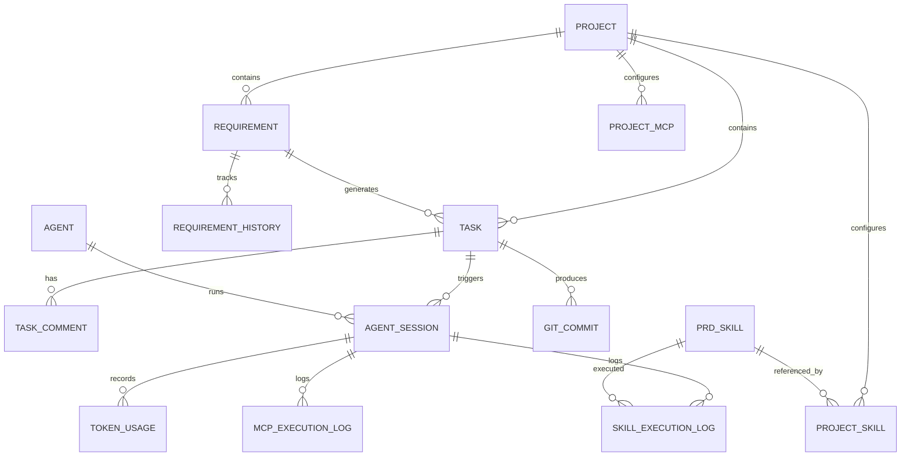
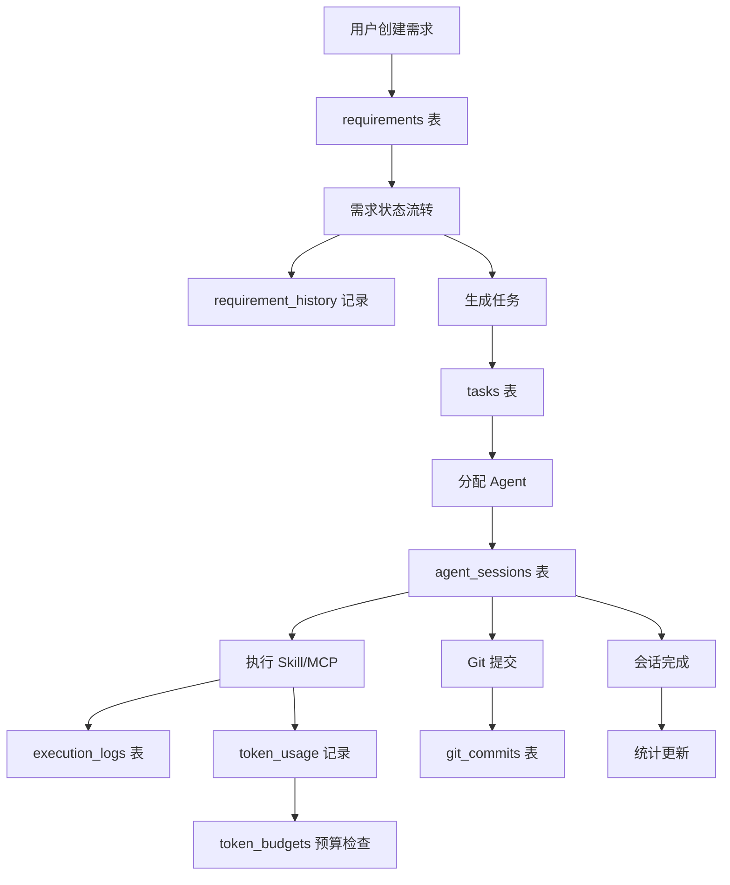
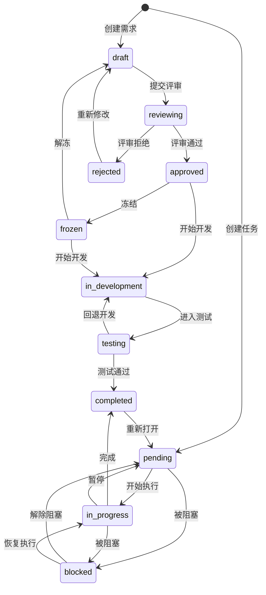

# AI研发协作平台 - 关联功能完整性需求规格

**版本**: 1.0
**生成时间**: 2026-09-20
**分析范围**: 前端 18 页面 + 后端 62 命令 + 17 数据库表 + 55 IPC 封装
**状态**: 待确认

---

## 1. 功能总览

### 1.1 现有功能清单

#### 1.1.1 已实现（前后端联通）- 45 项

| 编号 | 功能名称         | 前端位置                             | 后端命令                                                                       | 数据库表                                        |
| ---- | ---------------- | ------------------------------------ | ------------------------------------------------------------------------------ | ----------------------------------------------- |
| F001 | 需求 CRUD        | `src/pages/Requirements.tsx`         | `create/list/get/update/delete_requirement`                                    | `requirements`                                  |
| F002 | 需求详情编辑     | `src/pages/RequirementDetail.tsx`    | 同上                                                                           | 同上                                            |
| F003 | PRD 生成         | `src/pages/RequirementDetail.tsx`    | `generate_prd`                                                                 | -                                               |
| F004 | 任务看板         | `src/pages/Board.tsx`                | `create/list/update_task_status/delete_task`                                   | `tasks`                                         |
| F005 | 任务详情         | `src/pages/TaskDetail.tsx`           | `get_task/update_task`                                                         | 同上                                            |
| F006 | 任务评论         | `src/pages/TaskDetail.tsx`           | `create/list/delete_task_comment`                                              | `task_comments`                                 |
| F007 | 项目 CRUD        | `src/pages/Projects.tsx`             | `create/list/get/update/delete_project`                                        | `projects`                                      |
| F008 | 项目详情         | `src/pages/ProjectDetail.tsx`        | 同上                                                                           | 同上                                            |
| F009 | 项目 Skill 配置  | `src/pages/ProjectDetail.tsx`        | `list/add/remove_project_skill`                                                | `project_skills`                                |
| F010 | 项目 MCP 配置    | `src/pages/ProjectDetail.tsx`        | `list/add/remove_project_mcp`                                                  | `project_mcps`                                  |
| F011 | Skill 模板管理   | `src/pages/SkillManagement.tsx`      | `list/get/create/update/delete_prd_skill` + `create_custom_skill_from_builtin` | `prd_skills`                                    |
| F012 | Agent 发现       | `src/pages/Agents.tsx`               | `discover_agents/get_agents`                                                   | `agents`                                        |
| F013 | Agent 启停       | `src/pages/Agents.tsx`               | `start_agent/stop_agent`                                                       | `agent_sessions`                                |
| F014 | 会话管理         | `src/pages/Sessions.tsx`             | `get_agent_sessions`                                                           | `agent_sessions`                                |
| F015 | 会话详情         | `src/pages/SessionDetail.tsx`        | 同上 + 执行日志查询                                                            | + `skill_execution_logs` / `mcp_execution_logs` |
| F016 | PTY 终端         | `src/components/AgentTerminal.tsx`   | `pty_write/pty_resize/pty_kill`                                                | -                                               |
| F017 | Token 消耗       | `src/pages/Cost.tsx`                 | `get_token_usage_summary/trend/by_model`                                       | `token_usage`                                   |
| F018 | Token 预算       | `src/pages/Cost.tsx`                 | `get/set_token_budget`                                                         | `token_budgets`                                 |
| F019 | Token 本地同步   | `src/pages/Cost.tsx`                 | `sync_local_usage`                                                             | 同上                                            |
| F020 | 统计报表         | `src/pages/Statistics.tsx`           | `get_statistics`                                                               | -                                               |
| F021 | Git 提交历史     | `src/pages/Commits.tsx`              | `git_log/git_get_status/git_get_diff`                                          | `git_commits`                                   |
| F022 | Git 状态         | `src/pages/Commits.tsx`              | 同上                                                                           | 同上                                            |
| F023 | 设置管理         | `src/pages/Settings.tsx`             | `get/set_setting`                                                              | `settings`                                      |
| F024 | API Key 加密     | `src/pages/Settings.tsx`             | `encrypt/decrypt_api_key`                                                      | -                                               |
| F025 | 导入导出         | `src/pages/ImportExport.tsx`         | 待确认                                                                         | -                                               |
| F026 | 系统监控         | `src/pages/SystemMonitor.tsx`        | `get_monitor_data/check_alerts`                                                | -                                               |
| F027 | 工作台仪表盘     | `src/pages/Workspace.tsx`            | `get_statistics`                                                               | -                                               |
| F028 | 布局/导航        | `src/components/Layout.tsx`          | -                                                                              | -                                               |
| F029 | Toast 通知       | `src/components/Toast.tsx`           | -                                                                              | -                                               |
| F030 | 分页             | `src/components/Pagination.tsx`      | -                                                                              | -                                               |
| F031 | 徽章组件         | `src/components/Badges.tsx`          | -                                                                              | -                                               |
| F032 | 骨架屏           | `src/components/Skeleton.tsx`        | -                                                                              | -                                               |
| F033 | 数字动画         | `src/components/AnimatedNumber.tsx`  | -                                                                              | -                                               |
| F034 | 附件列表         | `src/components/AttachmentList.tsx`  | -                                                                              | -                                               |
| F035 | 需求表单         | `src/components/RequirementForm.tsx` | -                                                                              | -                                               |
| F036 | 任务表单         | `src/components/TaskForm.tsx`        | -                                                                              | -                                               |
| F037 | 富文本编辑器     | `src/components/RichTextEditor.tsx`  | -                                                                              | -                                               |
| F038 | 错误边界         | `src/components/ErrorBoundary.tsx`   | -                                                                              | -                                               |
| F039 | PTY 会话管理     | `src-tauri/src/pty.rs`               | `pty_spawn`                                                                    | -                                               |
| F040 | LLM API 调用     | `src-tauri/src/llm.rs`               | -                                                                              | -                                               |
| F041 | AES-256-GCM 加密 | `src-tauri/src/crypto.rs`            | -                                                                              | -                                               |
| F042 | LRU 缓存         | `src-tauri/src/cache.rs`             | -                                                                              | -                                               |
| F043 | 数据库 WAL 模式  | `src-tauri/src/db/mod.rs`            | -                                                                              | -                                               |
| F044 | 系统托盘         | `src-tauri/src/tray.rs`              | -                                                                              | -                                               |
| F045 | 主题切换         | `src/stores/themeStore.ts`           | -                                                                              | -                                               |

#### 1.1.2 部分实现 - 9 项

| 编号 | 功能名称           | 缺口说明                                                                       |
| ---- | ------------------ | ------------------------------------------------------------------------------ |
| F046 | 审计日志           | UI 页面存在但 `loadLogs()` 返回空数组，后端无 `get_audit_logs` 命令            |
| F047 | 需求关联项目       | `requirements.project_id` 字段存在但 `create_requirement` 不设置               |
| F048 | 需求历史记录       | `requirement_history` 表已建但无写入/查询逻辑                                  |
| F049 | PTY 终端（完整）   | `pty_spawn/pty_get_sessions/pty_get_session` 后端已注册但前端 IPC 无封装       |
| F050 | Git 提交创建       | `git_create_commit` 后端已注册但前端无封装                                     |
| F051 | 缓存管理           | `get_cache_stats/clear_cache` 后端已实现但无 UI                                |
| F052 | Skill/MCP 使用统计 | `get_skill_usage_stats/get_mcp_usage_stats` 后端已实现但无 UI                  |
| F053 | 需求状态校验       | 后端有 `validate_requirement_status_transition` 但 `update_requirement` 未调用 |
| F054 | 任务状态校验       | 后端有 `validate_task_status_transition` 但 `update_task_status` 未调用        |

#### 1.1.3 仅规划/UI 桩 - 4 项

| 编号 | 功能名称       | 缺口说明                                             |
| ---- | -------------- | ---------------------------------------------------- |
| F055 | 暗色主题       | `themeStore` 定义了 dark 模式但 CSS 变量无 dark 变体 |
| F056 | 用户/角色/权限 | 无任何认证鉴权机制                                   |
| F057 | 帮助/文档/关于 | 无任何帮助入口                                       |
| F058 | 国际化         | 所有文案硬编码中文                                   |

### 1.2 建议新增功能清单

| 编号 | 功能名称               | 来源问题      | 优先级 | 实现成本 |
| ---- | ---------------------- | ------------- | ------ | -------- |
| S001 | 审计日志后端服务       | #1, #2        | Must   | 中       |
| S002 | 需求关联项目           | #5, #6        | Must   | 低       |
| S003 | 需求历史记录展示       | #2            | Should | 低       |
| S004 | Git 提交功能           | #3            | Must   | 低       |
| S005 | PTY 完整封装           | #4            | Should | 中       |
| S006 | 缓存管理 UI            | #15           | Could  | 低       |
| S007 | Skill/MCP 使用统计 UI  | #16           | Could  | 中       |
| S008 | 状态流转校验（前后端） | #7, #8        | Must   | 低       |
| S009 | 项目删除级联检查       | #9            | Must   | 低       |
| S010 | 暗色主题               | #10           | Should | 中       |
| S011 | API Key 加密存储流程   | #14           | Must   | 中       |
| S012 | CSP 安全策略           | #13           | Should | 低       |
| S013 | 错误处理增强           | #4            | Should | 中       |
| S014 | PTY 事件桥接修复       | #11           | Should | 中       |
| S015 | 类型定义统一           | #20, #21, #22 | Could  | 低       |
| S016 | 帮助/关于页面          | #17           | Could  | 低       |
| S017 | 输入校验增强           | #14           | Should | 低       |
| S018 | 数据生命周期完整性     | 全局          | Should | 高       |

---

## 2. 功能关联图谱

### 2.1 核心实体关系



### 2.2 数据流



### 2.3 状态机



---

## 3. 关联完整性报告

| #   | 严重程度 | 问题类型 | 涉及功能          | 问题描述                                       | 证据                                   | 影响                        | 建议             |
| --- | -------- | -------- | ----------------- | ---------------------------------------------- | -------------------------------------- | --------------------------- | ---------------- |
| 1   | CRITICAL | 断裂     | F046 审计日志     | `loadLogs()` 返回空数组，后端无查询命令        | `AuditLog.tsx:25`                      | 用户无法查看任何操作历史    | 新增 S001        |
| 2   | CRITICAL | 缺失     | F048 需求历史     | `requirement_history` 表已建但无写入逻辑       | `db/mod.rs:220`                        | 需求变更无法追溯            | 新增 S003        |
| 3   | CRITICAL | 断裂     | F050 Git 提交     | `git_create_commit` 后端已注册但前端无封装     | `commands.rs:799`                      | 用户无法从 UI 提交代码      | 新增 S004        |
| 4   | HIGH     | 断裂     | F049 PTY 完整     | 3 个 PTY 命令前端无 IPC 封装                   | `main.rs:209-214`                      | 终端会话管理不完整          | 新增 S005        |
| 5   | HIGH     | 缺失     | F047 需求项目关联 | `create_requirement` 不接收 `project_id`       | `commands.rs:11-26`                    | 需求无法归属项目            | 新增 S002        |
| 6   | HIGH     | 不一致   | F047 需求项目关联 | 数据库有 `project_id` 但命令不设置             | `db/mod.rs:113`                        | 数据冗余/不一致             | 新增 S002        |
| 7   | HIGH     | 缺失     | F053 需求状态校验 | `update_requirement` 未调用状态校验            | `commands.rs:72`                       | 非法状态流转可发生          | 新增 S008        |
| 8   | HIGH     | 缺失     | F054 任务状态校验 | `update_task_status` 未调用状态校验            | `commands.rs:173`                      | 非法状态流转可发生          | 新增 S008        |
| 9   | HIGH     | 缺失     | F007 项目删除     | `delete_project` 不检查 skills/mcps            | `commands.rs:628-652`                  | 级联删除可能遗漏            | 新增 S009        |
| 10  | MEDIUM   | 缺失     | F055 暗色主题     | CSS 变量无 dark 变体                           | `themeStore.ts`                        | 暗色模式不可用              | 新增 S010        |
| 11  | MEDIUM   | 缺失     | F039 PTY 事件     | `_pty_event_receiver` 被丢弃                   | `main.rs:86`                           | PTY 事件可能丢失            | 新增 S014        |
| 12  | MEDIUM   | 缺失     | F056 用户权限     | 无认证鉴权机制                                 | 全局                                   | 无访问控制                  | 新增建议（远期） |
| 13  | MEDIUM   | 缺失     | 安全              | CSP 禁用                                       | `tauri.conf.json:23`                   | XSS 风险增加                | 新增 S012        |
| 14  | MEDIUM   | 缺失     | F024 API Key 加密 | 加密函数存在但设置流程未使用                   | `Settings.tsx`                         | 密钥明文存储                | 新增 S011        |
| 15  | MEDIUM   | 缺失     | F051 缓存管理     | 后端已实现但无 UI                              | `commands.rs:464-488`                  | 无法管理缓存                | 新增 S006        |
| 16  | MEDIUM   | 缺失     | F052 使用统计     | 后端已实现但无 UI                              | `commands.rs:757-780`                  | 无法查看 Skill/MCP 使用情况 | 新增 S007        |
| 17  | MEDIUM   | 缺失     | F057 帮助文档     | 无帮助入口                                     | 全局                                   | 用户无引导                  | 新增 S016        |
| 18  | MEDIUM   | 缺失     | 项目配置 UI       | `project_skills`/`project_mcps` 无独立页面     | `ProjectDetail.tsx`                    | 配置入口隐蔽                | 标记为已知限制   |
| 19  | LOW      | 冗余     | F016 PTY 终端     | `AgentTerminal` 直接调用 IPC 不经过 `tauri.ts` | `AgentTerminal.tsx:121`                | 封装不一致                  | 新增 S015        |
| 20  | LOW      | 不一致   | F026 系统监控     | `MonitorData` 接口重复定义                     | `Layout.tsx:23`, `SystemMonitor.tsx:5` | 维护成本                    | 新增 S015        |
| 21  | LOW      | 缺失     | F021 Git 提交     | `CommitRecord` 本地定义未复用                  | `Commits.tsx:13`                       | 类型不统一                  | 新增 S015        |
| 22  | LOW      | 缺失     | F046 审计日志     | `AuditEntry` 本地定义未复用                    | `AuditLog.tsx:4`                       | 类型不统一                  | 新增 S015        |
| 23  | LOW      | 缺失     | F058 国际化       | 所有文案硬编码中文                             | 全局                                   | 不支持多语言                | 新增建议（远期） |

---

## 4. 详细需求

### 4.1 S001: 审计日志后端服务

**需求编号**: S001
**目标用户**: 项目管理员、团队负责人
**优先级**: Must
**实现成本**: 中
**关联问题**: #1, #2

**用户故事**: 作为项目管理员，我希望查看系统中所有实体的操作历史，以便审计和追溯变更。

**使用场景与前置条件**:

- 前置条件：系统已初始化，数据库可用
- 场景1：查看需求的所有变更历史
- 场景2：查看任务的状态变更记录
- 场景3：查看项目的创建/修改/删除记录
- 场景4：按实体类型和时间范围筛选

**主流程**:

1. 用户导航到审计日志页面
2. 前端调用 `get_audit_logs` IPC
3. 后端从 `requirement_history` 表查询记录
4. 返回分页结果
5. 前端渲染日志列表

**异常流程**:

- 查询失败：显示 Toast 错误提示
- 无数据：显示空状态 "暂无操作记录"

**边界条件**:

- 单次查询最多返回 100 条记录
- 支持按 `entity_type` 筛选（requirement/task/project）
- 支持按关键词搜索

**输入与输出**:

- 输入：`page: Option<u32>`, `page_size: Option<u32>`, `entity_type: Option<String>`, `search: Option<String>`
- 输出：`PagedResult<AuditEntry>`，包含 `id, entity_type, entity_id, action, old_value, new_value, created_at`

**依赖与关联功能**:

- 依赖：`requirement_history` 表（已存在）
- 下游：`AuditLog.tsx` 页面（已存在，需修改 `loadLogs`）

**状态变化**: 无（只读查询）

**权限控制**: 无（单机版 MVP 无用户系统）

**接口与数据契约**:

```
IPC: get_audit_logs
Params: { page?: number, pageSize?: number, entityType?: string, search?: string }
Returns: PagedResult<AuditEntry>
```

**非功能需求**:

- 性能：查询响应 < 200ms
- 安全：无特殊要求（本地应用）

**验收标准**:

```
Given 审计日志页面已打开
When 用户查看日志列表
Then 显示所有操作记录，按时间倒序排列

Given 需求被修改
When 用户查看审计日志
Then 看到该需求的变更记录，包含 old_value 和 new_value

Given 无操作记录
When 用户查看审计日志
Then 显示空状态 "暂无操作记录"
```

**对应代码模块**:

- 修改：`src/pages/AuditLog.tsx`（`loadLogs` 函数）
- 新增：`src/lib/tauri.ts`（`getAuditLogs` 封装）
- 修改：`src-tauri/src/commands.rs`（新增 `get_audit_logs` 命令）
- 修改：`src-tauri/src/db/mod.rs`（新增查询方法）

**测试要点**:

- 需求创建后审计日志有记录
- 需求修改后审计日志有 old_value/new_value
- 项目删除后审计日志有记录
- 分页查询正确
- 筛选功能正确

---

### 4.2 S002: 需求关联项目

**需求编号**: S002
**目标用户**: 产品经理、项目经理
**优先级**: Must
**实现成本**: 低
**关联问题**: #5, #6

**用户故事**: 作为产品经理，我希望将需求归属到具体项目，以便按项目维度管理需求。

**使用场景与前置条件**:

- 前置条件：至少存在一个项目
- 场景1：创建需求时选择所属项目
- 场景2：按项目筛选需求列表
- 场景3：项目详情页查看关联需求

**主流程**:

1. 用户在需求表单中选择项目（下拉框）
2. 提交时携带 `project_id`
3. 后端写入 `requirements.project_id`
4. 列表页支持按项目筛选

**异常流程**:

- 无项目时显示提示 "请先创建项目"
- 项目被删除时需求的 `project_id` 置为 NULL（级联处理）

**边界条件**:

- `project_id` 为可选字段
- 一个需求只能属于一个项目
- 一个项目可有多个需求

**输入与输出**:

- 输入：`createRequirement` 增加 `project_id?: string` 参数
- 输出：`Requirement` 对象包含 `project_id` 字段

**依赖与关联功能**:

- 依赖：F007 项目 CRUD（已存在）
- 下游：F001 需求 CRUD（需修改）

**状态变化**: 无

**接口与数据契约**:

```
IPC: create_requirement
新增参数: { projectId?: string }
修改: Requirement 类型增加 projectId 字段
```

**验收标准**:

```
Given 存在项目 "测试项目"
When 创建需求时选择该项目
Then 需求的 project_id 被正确设置

Given 需求已关联项目
When 在需求列表按项目筛选
Then 仅显示该项目的需求

Given 项目有 3 个关联需求
When 删除该项目
Then 删除被阻止，提示 "项目下有 3 个需求，请先清理"
```

**对应代码模块**:

- 修改：`src-tauri/src/commands.rs:11`（`create_requirement` 增加 `project_id`）
- 修改：`src-tauri/src/services/requirement_service.rs`
- 修改：`src/components/RequirementForm.tsx`（增加项目选择）
- 修改：`src/pages/Requirements.tsx`（增加项目筛选）
- 修改：`src/lib/types.ts`（`Requirement` 增加 `projectId`）

---

### 4.3 S003: 需求历史记录展示

**需求编号**: S003
**目标用户**: 产品经理、开发者
**优先级**: Should
**实现成本**: 低
**关联问题**: #2

**用户故事**: 作为产品经理，我希望在需求详情页查看该需求的所有变更历史，以便了解需求演进过程。

**主流程**:

1. 用户在需求详情页点击 "变更历史" 标签
2. 前端调用 `get_requirement_history` IPC
3. 后端从 `requirement_history` 表查询
4. 显示变更时间线

**验收标准**:

```
Given 需求被修改过
When 查看变更历史
Then 显示按时间倒序的变更列表，包含 action/old_value/new_value

Given 需求无变更历史
When 查看变更历史
Then 显示 "暂无变更记录"
```

**对应代码模块**:

- 修改：`src/pages/RequirementDetail.tsx`（增加历史标签）
- 新增：`src/lib/tauri.ts`（`getRequirementHistory`）
- 新增：`src-tauri/src/commands.rs`（`get_requirement_history` 命令）

---

### 4.4 S004: Git 提交功能

**需求编号**: S004
**目标用户**: 开发者
**优先级**: Must
**实现成本**: 低
**关联问题**: #3

**用户故事**: 作为开发者，我希望从应用内提交 Git 代码，以便快速完成代码管理闭环。

**主流程**:

1. 用户在代码提交页面查看变更文件
2. 点击 "提交" 按钮
3. 输入提交信息
4. 前端调用 `gitCreateCommit` IPC
5. 后端执行 `git add . && git commit`
6. 刷新提交历史

**异常流程**:

- 无变更：提示 "没有可提交的变更"
- 提交信息为空：提示 "请输入提交信息"
- Git 未配置：提示 "请先配置 Git 用户信息"

**验收标准**:

```
Given 有未提交的文件
When 输入提交信息并点击提交
Then 执行 git commit，提交历史刷新

Given 无未提交文件
When 点击提交
Then 提示 "没有可提交的变更"
```

**对应代码模块**:

- 新增：`src/lib/tauri.ts`（`gitCreateCommit` 封装）
- 修改：`src/pages/Commits.tsx`（增加提交表单）
- 后端已实现：`src-tauri/src/commands.rs:799`（`git_create_commit`）

---

### 4.5 S005: PTY 完整封装

**需求编号**: S005
**目标用户**: 开发者
**优先级**: Should
**实现成本**: 中
**关联问题**: #4

**用户故事**: 作为开发者，我希望完整的终端会话管理能力，包括创建、查询、销毁。

**主流程**:

1. 在 `tauri.ts` 中封装 `ptySpawn`, `ptyGetSessions`, `ptyGetSession`
2. AgentTerminal 使用封装后的 IPC

**验收标准**:

```
Given 需要创建终端会话
When 调用 ptySpawn
Then 返回 session_id，终端可用

Given 存在活跃会话
When 调用 ptyGetSessions
Then 返回所有活跃会话列表
```

**对应代码模块**:

- 新增：`src/lib/tauri.ts`（`ptySpawn`, `ptyGetSessions`, `ptyGetSession`）
- 修改：`src/components/AgentTerminal.tsx`（使用封装后的 IPC）
- 后端已注册：`src-tauri/src/main.rs:209-214`

---

### 4.6 S006: 缓存管理 UI

**需求编号**: S006
**目标用户**: 系统管理员
**优先级**: Could
**实现成本**: 低
**关联问题**: #15

**用户故事**: 作为系统管理员，我希望查看和清理缓存，以便维护系统性能。

**主流程**:

1. 在设置页面增加 "缓存管理" 区域
2. 显示缓存命中率、条目数
3. 提供 "清理缓存" 按钮

**验收标准**:

```
Given 缓存有数据
When 查看缓存统计
Then 显示命中率和条目数

When 点击清理缓存
Then 缓存被清空，统计归零
```

**对应代码模块**:

- 新增：`src/lib/tauri.ts`（`getCacheStats`, `clearCache`）
- 修改：`src/pages/Settings.tsx`（增加缓存管理区域）
- 后端已实现：`src-tauri/src/commands.rs:464-488`

---

### 4.7 S007: Skill/MCP 使用统计 UI

**需求编号**: S007
**目标用户**: 项目经理
**优先级**: Could
**实现成本**: 中
**关联问题**: #16

**用户故事**: 作为项目经理，我希望查看各 Skill 和 MCP 的使用频率和成功率，以便优化配置。

**主流程**:

1. 在统计报表页面增加 Skill/MCP 使用分布图
2. 显示各 Skill 的调用次数、成功率、平均耗时

**验收标准**:

```
Given 有 Skill 执行记录
When 查看统计报表
Then 显示 Skill 使用分布图
```

**对应代码模块**:

- 新增：`src/lib/tauri.ts`（`getSkillUsageStats`, `getMcpUsageStats`）
- 修改：`src/pages/Statistics.tsx`（增加 Skill/MCP 统计图表）
- 后端已实现：`src-tauri/src/commands.rs:757-780`

---

### 4.8 S008: 状态流转校验（前后端）

**需求编号**: S008
**目标用户**: 全部用户
**优先级**: Must
**实现成本**: 低
**关联问题**: #7, #8

**用户故事**: 作为用户，我希望系统阻止非法的状态流转，以保证数据一致性。

**主流程**:

1. 后端 `update_requirement` 和 `update_task_status` 调用状态校验函数
2. 非法流转返回错误
3. 前端显示错误提示

**边界条件**:

- 需求状态机：`draft→reviewing→approved→in_development→testing→completed`
- 任务状态机：`pending→in_progress→completed`, `pending→blocked→in_progress`
- `rejected` 可回退到 `draft`

**验收标准**:

```
Given 需求状态为 "draft"
When 尝试直接改为 "completed"
Then 返回错误 "不允许从 draft 转换到 completed"

Given 任务状态为 "completed"
When 尝试改为 "in_progress"
Then 返回错误 "不允许从 completed 转换到 in_progress"
```

**对应代码模块**:

- 修改：`src-tauri/src/commands.rs:72`（`update_requirement` 调用校验）
- 修改：`src-tauri/src/commands.rs:173`（`update_task_status` 调用校验）
- 后端已有：`src-tauri/src/validation.rs:64-103`

---

### 4.9 S009: 项目删除级联检查

**需求编号**: S009
**目标用户**: 项目经理
**优先级**: Must
**实现成本**: 低
**关联问题**: #9

**用户故事**: 作为项目经理，我希望删除项目时系统检查所有关联数据，以防止数据丢失。

**主流程**:

1. `delete_project` 检查 requirements、tasks、project_skills、project_mcps
2. 任一有数据则阻止删除

**验收标准**:

```
Given 项目有 2 个 Skill 配置
When 尝试删除项目
Then 返回错误 "项目下有 2 个 Skill 配置和 0 个 MCP 配置，请先清理"
```

**对应代码模块**:

- 修改：`src-tauri/src/commands.rs:628-652`（增加 skills/mcps 检查）

---

### 4.10 S010: 暗色主题

**需求编号**: S010
**目标用户**: 全部用户
**优先级**: Should
**实现成本**: 中
**关联问题**: #10

**用户故事**: 作为用户，我希望使用暗色主题，以减少眼睛疲劳。

**主流程**:

1. 在 `tailwind.config.js` 添加 dark mode
2. 定义 dark 变体的 CSS 变量
3. `themeStore` 切换时添加/移除 `dark` class

**验收标准**:

```
Given 用户选择暗色主题
When 应用主题
Then 所有页面使用暗色配色

Given 用户选择亮色主题
When 应用主题
Then 所有页面使用亮色配色
```

**对应代码模块**:

- 修改：`tailwind.config.js`（添加 `darkMode: 'class'`）
- 新增：`src/styles/dark.css`（dark 变体 CSS 变量）
- 修改：`src/stores/themeStore.ts`（切换时操作 DOM class）

---

### 4.11 S011: API Key 加密存储流程

**需求编号**: S011
**目标用户**: 全部用户
**优先级**: Must
**实现成本**: 中
**关联问题**: #14

**用户故事**: 作为用户，我希望 API Key 加密存储，以保护敏感信息。

**主流程**:

1. 用户输入 API Key
2. 系统用密码加密后存储到 settings 表
3. 需要使用时解密

**验收标准**:

```
Given 用户输入 API Key
When 保存设置
Then 数据库中存储的是加密后的值

Given 数据库中有加密的 API Key
When 应用需要调用 LLM
Then 自动解密并使用
```

**对应代码模块**:

- 修改：`src/pages/Settings.tsx`（保存时调用 `encryptApiKey`）
- 修改：`src-tauri/src/llm.rs`（读取时调用 `decryptApiKey`）
- 后端已有：`src-tauri/src/crypto.rs`

---

### 4.12 S012: CSP 安全策略

**需求编号**: S012
**目标用户**: 系统管理员
**优先级**: Should
**实现成本**: 低
**关联问题**: #13

**用户故事**: 作为系统管理员，我希望启用 CSP 策略以增强安全性。

**验收标准**:

```
Given CSP 已配置
When 应用运行
Then 内联脚本和外部未授权资源被阻止
```

**对应代码模块**:

- 修改：`src-tauri/tauri.conf.json:23`（设置 CSP 规则）

---

### 4.13 S013: 错误处理增强

**需求编号**: S013
**目标用户**: 开发者、用户
**优先级**: Should
**实现成本**: 中
**关联问题**: #4

**用户故事**: 作为用户，我希望所有操作都有清晰的错误反馈，以便理解问题。

**主流程**:

1. 后端统一错误格式
2. 前端统一错误展示（Toast + 详情）

**验收标准**:

```
Given 后端返回错误
When 前端收到错误
Then 显示 Toast 提示，包含错误类型和消息
```

**对应代码模块**:

- 修改：`src/lib/tauri.ts`（统一错误处理中间件）
- 修改：`src/components/Toast.tsx`（支持错误详情展示）

---

### 4.14 S014: PTY 事件桥接修复

**需求编号**: S014
**目标用户**: 开发者
**优先级**: Should
**实现成本**: 中
**关联问题**: #11

**用户故事**: 作为开发者，我希望 PTY 事件正确传递到前端终端。

**主流程**:

1. 修复 `main.rs` 中 `_pty_event_receiver` 被丢弃的问题
2. 通过 Tauri 事件系统转发 `PtyEvent` 到前端

**验收标准**:

```
Given Agent 进程输出数据
When PTY 事件触发
Then 前端终端正确显示输出
```

**对应代码模块**：

- 修改：`src-tauri/src/main.rs:86`（正确处理 `_pty_event_receiver`）

---

### 4.15 S015: 类型定义统一

**需求编号**: S015
**目标用户**: 开发者
**优先级**: Could
**实现成本**: 低
**关联问题**: #20, #21, #22

**用户故事**: 作为开发者，我希望所有类型定义集中在 `types.ts`，以便维护。

**对应代码模块**:

- 修改：`src/lib/types.ts`（统一 `MonitorData`, `CommitRecord`, `AuditEntry`）
- 修改：`src/components/Layout.tsx`, `src/pages/SystemMonitor.tsx`, `src/pages/Commits.tsx`, `src/pages/AuditLog.tsx`

---

### 4.16 S016: 帮助/关于页面

**需求编号**: S016
**目标用户**: 全部用户
**优先级**: Could
**实现成本**: 低
**关联问题**: #17

**用户故事**: 作为用户，我希望有帮助入口和关于页面，以便了解应用信息。

**对应代码模块**:

- 新增：`src/pages/About.tsx`
- 修改：`src/App.tsx`（添加路由）
- 修改：`src/components/Layout.tsx`（添加导航入口）

---

### 4.17 S017: 输入校验增强

**需求编号**: S017
**目标用户**: 全部用户
**优先级**: Should
**实现成本**: 低
**关联问题**: #14

**用户故事**: 作为用户，我希望系统在前端也进行输入校验，以提供即时反馈。

**验收标准**:

```
Given 用户输入超过 200 字符的标题
When 点击提交
Then 前端立即提示 "标题不能超过200个字符"
```

**对应代码模块**:

- 修改：`src/components/RequirementForm.tsx`（前端校验）
- 修改：`src/components/TaskForm.tsx`（前端校验）

---

### 4.18 S018: 数据生命周期完整性

**需求编号**: S018
**目标用户**: 系统管理员
**优先级**: Should
**实现成本**: 高
**关联问题**: 全局

**用户故事**: 作为系统管理员，我希望数据有完整的生命周期管理（创建、更新、归档、导出、清理）。

**主流程**:

1. 数据归档：超过一定时间的已完成需求/任务可归档
2. 数据导出：支持按项目/时间范围导出
3. 数据清理：支持清理历史数据

**对应代码模块**:

- 新增：归档功能（后端命令 + 前端 UI）
- 修改：`src/pages/ImportExport.tsx`（增强导出功能）

---

## 5. 需求与测试映射

| 需求编号 | 测试层级   | 测试用例建议                                  |
| -------- | ---------- | --------------------------------------------- |
| S001     | L1, L3, L6 | 审计日志查询、筛选、分页、空状态              |
| S002     | L1, L3, L6 | 需求创建带 project_id、项目筛选、级联删除检查 |
| S003     | L1, L3     | 需求历史查询、空状态                          |
| S004     | L1, L3, L6 | Git 提交、无变更提示、提交信息校验            |
| S005     | L1, L3, L6 | PTY spawn/sessions/session 查询               |
| S006     | L1, L3     | 缓存统计、清理缓存                            |
| S007     | L1, L3     | Skill/MCP 使用统计查询                        |
| S008     | L1, L3, L5 | 非法状态流转拒绝、合法状态流转通过            |
| S009     | L1, L3     | 项目删除检查 skills/mcps                      |
| S010     | L2         | 暗色主题切换、所有页面配色正确                |
| S011     | L1, L3     | API Key 加密存储、解密使用                    |
| S012     | L2         | CSP 策略生效                                  |
| S013     | L1, L5     | 错误信息展示、异常处理                        |
| S014     | L1         | PTY 事件传递                                  |
| S015     | L1         | 类型定义一致性                                |
| S016     | L2         | 帮助页面可访问                                |
| S017     | L1         | 前端输入校验                                  |
| S018     | L3         | 数据归档、导出、清理                          |

---

## 6. 待确认问题清单

| #   | 问题                                                     | 影响范围 | 建议决策                         |
| --- | -------------------------------------------------------- | -------- | -------------------------------- |
| Q1  | 是否需要用户/角色/权限系统？                             | 全局     | 单机版 MVP 可暂不实现，远期规划  |
| Q2  | 是否需要国际化支持？                                     | 全局     | 单机版 MVP 可暂不实现            |
| Q3  | `pty_event_receiver` 丢失是设计如此还是 Bug？            | PTY 终端 | 需确认是否有意为之               |
| Q4  | `delete_project` 不检查 skills/mcps 是遗漏还是设计决策？ | 项目管理 | 建议补充检查                     |
| Q5  | 需求状态流转校验是否需要在前端也实现？                   | 状态管理 | 建议前后端双重校验               |
| Q6  | 暗色主题的优先级是否需要提升？                           | UI       | 取决于用户反馈                   |
| Q7  | 审计日志需要记录哪些实体的操作？                         | 审计     | 建议：requirement, task, project |
| Q8  | API Key 加密存储是否需要用户输入密码？                   | 安全     | 建议：使用设备绑定密钥           |

---

## 7. 变更记录

| 版本 | 日期       | 变更内容                                                                                                 |
| ---- | ---------- | -------------------------------------------------------------------------------------------------------- |
| 1.0  | 2026-09-20 | 初始版本：检索 62 个后端命令、18 个前端页面、17 个数据库表；发现 23 个关联完整性问题；生成 18 条建议功能 |
